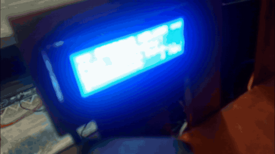

```
     ___  ___  ___  ___  ___  ___  ___  ___  ___  ___  ___  ___  ___
    |   ||   ||   ||   ||   ||   ||   ||   ||   ||   ||   ||   ||   |
    | P || A || R || K ||   || E || A || S || Y ||   ||   ||   ||   |
    |___||___||___||___||___||___||___||___||___||___||___||___||___|

    ⚡ E S P 3 2   F I R M W A R E ⚡

         ┌──────────────────────────────────────┐
         │  ╔══════════════════════════════════╗ │
         │  ║   🔌 SMART PARKING CONTROLLER  ║ │
         │  ║                                  ║ │
         │  ║   [GPIO13]──→ SERVO MASUK       ║ │
         │  ║   [GPIO12]──→ SERVO KELUAR      ║ │
         │  ║   [GPIO21]──→ SDA (I2C BUS)     ║ │
         │  ║   [GPIO22]──→ SCL (I2C BUS)     ║ │
         │  ║   [GPIO14]──→ TRIG HC-SR04 #1   ║ │
         │  ║   [GPIO27]──→ ECHO HC-SR04 #1   ║ │
         │  ║   [GPIO26]──→ TRIG HC-SR04 #2   ║ │
         │  ║   [GPIO25]──→ ECHO HC-SR04 #2   ║ │
         │  ║   [GPIO18]──→ BUZZER MASUK      ║ │
         │  ║   [GPIO19]──→ BUZZER KELUAR     ║ │
         │  ║                                  ║ │
         │  ║         ESP32 DevKit V1          ║ │
         │  ╚══════════════════════════════════╝ │
         │          [USB]  [RESET]  [BOOT]       │
         └──────────────────────────────────────┘
```

<div align="center">

# 🅿️ ParkEasy — ESP32 Firmware

### 🧠 *Otak dari Sistem Parkir Cerdas ParkEasy*

[](https://www.arduino.cc/)
[](https://www.espressif.com/)
[](https://isocpp.org/)
[](https://en.wikipedia.org/wiki/Internet_of_things)
[](LICENSE)

---

**Firmware ini adalah komponen hardware dari sistem ParkEasy** — sebuah sistem parkir cerdas yang menggabungkan deteksi kendaraan otomatis, kontrol palang gerbang, monitoring slot parkir real-time, dan komunikasi serial dengan aplikasi desktop.

🔗 **Bagian dari ekosistem ParkEasy:**
- 🖥️ [ParkEasy_Laptop](https://github.com/Fahminurs/ParkEasy_Laptop) — Aplikasi Desktop (Python)
- ⚡ **ParkEasy_Alat** — Firmware ESP32 *(repo ini)*

</div>

---

## 🎬 Video Demo

<div align="center">

<a href="docs/demo-sidang.mp4">
  
</a>

**[▶️ Tonton video demo sidang skripsi lengkap (4:15)](docs/demo-sidang.mp4)**

*Alur lengkap di prototipe: kendaraan masuk → slot terisi terpantau sensor VL53L1X → kendaraan keluar, ditagih di LCD, lalu membayar lewat aplikasi.*

</div>

---

## 📋 Daftar Isi

- [🎬 Video Demo](#-video-demo)
- [🎯 Fitur Utama](#-fitur-utama)
- [🔧 Komponen Hardware](#-komponen-hardware)
- [📌 Pin Mapping & Wiring](#-pin-mapping--wiring)
- [📂 Struktur File](#-struktur-file)
- [📡 Protokol Komunikasi UART](#-protokol-komunikasi-uart)
- [🚀 Cara Upload ke ESP32](#-cara-upload-ke-esp32)
- [⚙️ Konfigurasi](#%EF%B8%8F-konfigurasi)

---

## 🎯 Fitur Utama

<table>
<tr>
<td width="50%">

### 🚗 Kontrol Gerbang Otomatis
- Servo SG90 untuk palang masuk & keluar
- Deteksi fisik servo via **ESP32 Touch Sensor** (kapasitansi hardware)
- Palang tetap terbuka selama kendaraan terdeteksi
- Auto-close setelah kendaraan melewati gerbang

</td>
<td width="50%">

### 📡 Deteksi Kendaraan
- **HC-SR04** (ultrasonik) di gerbang masuk & keluar — mendeteksi kedatangan kendaraan
- **VL53L1X** (Time-of-Flight) di setiap slot — monitoring ketersediaan slot real-time
- Error detection otomatis jika sensor rusak/terputus

</td>
</tr>
<tr>
<td width="50%">

### 📺 Tampilan LCD 20x4
- 2 LCD terpisah untuk gerbang masuk & keluar
- Animasi progress bar saat pemindaian (30% → 70% → 100%)
- Tampilan plat nomor, waktu masuk, tagihan parkir
- Layar idle informatif saat tidak ada aktivitas

</td>
<td width="50%">

### 🔔 Sistem Buzzer & Notifikasi
- Buzzer terpisah untuk setiap gerbang
- Pola bunyi berbeda: beep pendek (gagal), beep panjang (berhasil), beep ganda (notifikasi)
- Deteksi koneksi buzzer secara berkala
- Health monitoring semua sensor via heartbeat periodik

</td>
</tr>
</table>

---

## 🔧 Komponen Hardware

| No | Komponen | Jumlah | Fungsi |
|:---:|:---|:---:|:---|
| 1 | 🟢 **ESP32 DevKit V1** | 1 | Mikrokontroler utama, otak sistem |
| 2 | 📏 **HC-SR04** (Ultrasonik) | 2 | Deteksi kendaraan di gerbang masuk & keluar |
| 3 | ⚙️ **SG90** (Servo Motor) | 2 | Penggerak palang gerbang masuk & keluar |
| 4 | 🎯 **VL53L1X** (ToF Sensor) | 3 | Monitoring slot parkir (A1, A2, B1) |
| 5 | 🔀 **TCA9548A** (I2C Multiplexer) | 1 | Menghubungkan semua perangkat I2C ke satu bus |
| 6 | 📺 **LCD 20x4 I2C** | 2 | Tampilan informasi gerbang masuk & keluar |
| 7 | 🔔 **Buzzer Aktif** | 2 | Notifikasi suara gerbang masuk & keluar |

---

## 📌 Pin Mapping & Wiring

### 🔌 Koneksi Langsung ESP32

| GPIO | Komponen | Keterangan |
|:---:|:---|:---|
| `13` | Servo SG90 (Masuk) | PWM — Palang gerbang masuk |
| `12` | Servo SG90 (Keluar) | PWM — Palang gerbang keluar |
| `18` | Buzzer (Masuk) | Digital — Notifikasi gerbang masuk |
| `19` | Buzzer (Keluar) | Digital — Notifikasi gerbang keluar |
| `14` | HC-SR04 TRIG (Masuk) | Trigger ultrasonik gerbang masuk |
| `27` | HC-SR04 ECHO (Masuk) | Echo ultrasonik gerbang masuk |
| `26` | HC-SR04 TRIG (Keluar) | Trigger ultrasonik gerbang keluar |
| `25` | HC-SR04 ECHO (Keluar) | Echo ultrasonik gerbang keluar |
| `21` | TCA9548A SDA | I2C Data |
| `22` | TCA9548A SCL | I2C Clock |

### 🔀 Channel TCA9548A (I2C Multiplexer)

| Channel | Perangkat | Alamat I2C | Keterangan |
|:---:|:---|:---:|:---|
| `0` | LCD 20x4 (Masuk) | `0x27` | Display gerbang masuk |
| `1` | LCD 20x4 (Keluar) | `0x27` | Display gerbang keluar |
| `2` | VL53L1X Slot A1 | `0x29` | Sensor ToF slot parkir A1 |
| `3` | VL53L1X Slot A2 | `0x29` | Sensor ToF slot parkir A2 |
| `4` | VL53L1X Slot B1 | `0x29` | Sensor ToF slot parkir B1 |

> 💡 **Catatan:** TCA9548A memungkinkan penggunaan perangkat I2C dengan alamat yang sama pada channel berbeda (alamat multiplexer: `0x70`)

---

## 📂 Struktur File

```
📦 ParkEasy_Alat/
├── 📁 main/                       # Firmware utama
│   ├── 📄 main.ino                # Entry point — setup() & loop()
│   ├── 📄 config.h                # Definisi pin, alamat I2C, threshold, timing
│   ├── 📄 buzzer.h                # Kontrol buzzer + deteksi koneksi
│   ├── 📄 servo_gate.h            # Kontrol servo palang + deteksi fisik (touch sensor)
│   ├── 📄 hcsr04.h                # Sensor ultrasonik HC-SR04 (deteksi kendaraan)
│   ├── 📄 lcd_display.h           # LCD 20x4 via TCA9548A (animasi & tampilan)
│   ├── 📄 tof_sensor.h            # Sensor ToF VL53L1X (monitoring slot parkir)
│   └── 📄 uart_handler.h          # Parsing command UART dari Laptop
│
├── 📁 Test Tanpa Ai/              # Sketch pengujian tanpa integrasi AI
│   ├── 📄 Test Tanpa Ai.ino       # Sketch utama pengujian
│   ├── 📁 Test_Tiga_TOF/          # Test khusus 3 sensor ToF
│   └── 📄 ... (file pendukung)
│
├── 📁 docs/                       # Dokumentasi tambahan
│   └── 📄 PINOUT_ESP32.md         # Referensi pinout ESP32
│
├── 📄 .gitignore
└── 📄 README.md                   # Dokumentasi ini
```

### 📝 Penjelasan Setiap File

| File | Deskripsi |
|:---|:---|
| `main.ino` | Loop utama sistem — inisialisasi semua komponen, polling sensor berkala, heartbeat monitoring |
| `config.h` | Semua konstanta terpusat: pin GPIO, alamat I2C, threshold sensor, timing interval |
| `buzzer.h` | Pola buzzer (pendek/panjang/ganda) + deteksi koneksi buzzer via `INPUT_PULLUP` |
| `servo_gate.h` | Kontrol servo SG90 + deteksi fisik servo menggunakan `touchRead()` (kapasitansi hardware ESP32) |
| `hcsr04.h` | Pengukuran jarak ultrasonik + deteksi koneksi sensor secara real-time |
| `lcd_display.h` | Manajemen 2 LCD via TCA9548A — idle screen, animasi progress, pesan hasil, akses darurat |
| `tof_sensor.h` | Monitoring 3 slot parkir (A1, A2, B1) + auto-reconnect jika sensor terputus |
| `uart_handler.h` | Parsing command dari Laptop, dispatch ke modul yang sesuai (servo/LCD/buzzer) |

---

## 📡 Protokol Komunikasi UART

Komunikasi antara **Laptop** dan **ESP32** menggunakan Serial UART pada baudrate `115200`.

### ⬇️ Laptop → ESP32 (Command)

| Command | Format | Keterangan |
|:---|:---|:---|
| Animasi Kamera | `ANIM_KAMERA:MASUK` atau `ANIM_KAMERA:KELUAR` | Tampilkan animasi pemindaian kamera (30%) |
| Animasi Database | `ANIM_DATABASE:MASUK` atau `ANIM_DATABASE:KELUAR` | Tampilkan animasi pencocokan data (70%) |
| Masuk Berhasil | `MASUK:BERHASIL\|D 123 DX\|14:30:00` | Buka palang masuk, tampilkan plat & waktu |
| Masuk Darurat | `MASUK:DARURAT\|D 123 DX\|14:30:00` | Buka palang masuk mode darurat/manual |
| Masuk Gagal | `MASUK:GAGAL\|D 123 DX\|Alasan Gagal` | Tolak masuk, tampilkan alasan |
| Masuk Tidak Terdeteksi | `MASUK:TIDAK_TERDETEKSI` | Plat tidak terdeteksi kamera |
| Keluar Berhasil | `KELUAR:BERHASIL\|D 123 DX` | Buka palang keluar |
| Keluar Darurat | `KELUAR:DARURAT\|D 123 DX` | Buka palang keluar mode darurat |
| Keluar Belum Bayar | `KELUAR:BELUM_BAYAR\|D 123 DX\|5000` | Tolak, tampilkan tagihan |
| Keluar Gagal | `KELUAR:GAGAL\|D 123 DX\|Alasan` | Tolak keluar, tampilkan alasan |
| Keluar Tidak Terdeteksi | `KELUAR:TIDAK_TERDETEKSI` | Plat tidak terdeteksi kamera |
| Reset | `reset` | Restart ESP32 |

### ⬆️ ESP32 → Laptop (Status & Event)

| Event | Format | Keterangan |
|:---|:---|:---|
| Update Slot | `SLOT:A1:DITEMPATI` atau `SLOT:A1:TERSEDIA` | Perubahan status slot parkir (A1/A2/B1) |
| Masuk Selesai | `MASUK:SELESAI\|D 123 DX` | Kendaraan sudah melewati gerbang masuk |
| Keluar Selesai | `KELUAR:SELESAI\|D 123 DX` | Kendaraan sudah melewati gerbang keluar |
| Sensor HCSR04 | `[HCSR04_MASUK] 15.23` | Jarak baca sensor ultrasonik (cm) |
| Status Sensor | `[SERVO_MASUK] Berfungsi normal` | Heartbeat periodik komponen |
| Error Sensor | `[SERVO_MASUK] RUSAK - Servo tidak terhubung` | Sensor/aktuator terputus |
| Recovery | `[SERVO_MASUK] KEMBALI Terhubung` | Sensor/aktuator kembali terhubung |
| Heartbeat | `[HEARTBEAT] sistem aktif` | Sistem berjalan normal (tiap 10 detik) |

---

## 🚀 Cara Upload ke ESP32

### 1️⃣ Prasyarat

- **Arduino IDE** versi 2.x atau lebih baru
- **Kabel USB Micro-B** (data, bukan hanya charging)
- **Driver CP2102/CH340** (tergantung board ESP32)

### 2️⃣ Tambahkan Board ESP32

1. Buka **Arduino IDE** → `File` → `Preferences`
2. Pada **Additional Board Manager URLs**, tambahkan:
   ```
   https://raw.githubusercontent.com/espressif/arduino-esp32/gh-pages/package_esp32_index.json
   ```
3. Buka `Tools` → `Board` → `Boards Manager`
4. Cari **"esp32"** oleh Espressif Systems, lalu **Install**

### 3️⃣ Install Library

Buka `Tools` → `Manage Libraries`, lalu install:

| Library | Author | Fungsi |
|:---|:---|:---|
| **ESP32Servo** | Kevin Harrington | Kontrol servo motor pada ESP32 |
| **LiquidCrystal_I2C** | Frank de Brabander | LCD 20x4 via I2C |
| **VL53L1X** | Pololu | Sensor Time-of-Flight VL53L1X |

### 4️⃣ Konfigurasi Board

| Setting | Nilai |
|:---|:---|
| Board | `ESP32 Dev Module` |
| Upload Speed | `921600` |
| CPU Frequency | `240MHz (WiFi/BT)` |
| Flash Frequency | `80MHz` |
| Flash Mode | `QIO` |
| Flash Size | `4MB (32Mb)` |
| Partition Scheme | `Default 4MB with spiffs` |
| Port | *(pilih port COM ESP32)* |

### 5️⃣ Upload

1. Buka file `main/main.ino` di Arduino IDE
2. Klik tombol **Upload** (→) atau tekan `Ctrl+U`
3. Tunggu hingga proses upload selesai
4. Buka **Serial Monitor** pada baudrate `115200` untuk memantau output

---

## ⚙️ Konfigurasi

Semua parameter dapat diubah di file `main/config.h`:

```cpp
// Threshold sensor ultrasonik (deteksi kendaraan di gerbang)
#define DETECT_DISTANCE_CM  10    // kendaraan terdeteksi jika jarak < 10 cm

// Threshold sensor ToF (monitoring slot parkir)
#define TOF_OCCUPIED_MM     150   // slot ditempati jika jarak < 150 mm
#define TOF_EMPTY_MM        200   // slot kosong jika jarak >= 200 mm

// Sudut servo palang
#define SERVO_OPEN          90    // derajat palang terbuka
#define SERVO_CLOSE         0     // derajat palang tertutup

// Timing
#define GATE_OPEN_MS        5000  // waktu palang terbuka (ms)
#define SERIAL_BAUD         115200
```

---

## 🔍 Health Monitoring

Firmware ini memiliki sistem monitoring kesehatan bawaan yang berjalan secara otomatis:

| Komponen | Interval | Metode Deteksi |
|:---|:---:|:---|
| Servo SG90 | 5 detik | `touchRead()` — kapasitansi hardware ESP32 |
| HC-SR04 | 1 detik | Validasi pembacaan jarak (2–400 cm) |
| Buzzer | 2 detik | `INPUT_PULLUP` — cek koneksi fisik |
| VL53L1X | 500 ms | I2C status + auto-reconnect (timeout 5 detik) |
| LCD 20x4 | 10 detik | I2C ping via TCA9548A |
| Sistem | 10 detik | Heartbeat `[HEARTBEAT] sistem aktif` |

> 🛡️ Jika sensor terputus, firmware akan mengirim notifikasi `RUSAK` ke Laptop dan mencoba reconnect otomatis. Saat sensor kembali terhubung, pesan `KEMBALI Terhubung` dikirim.

---

## 🔄 Alur Kerja Sistem

```
┌─────────────┐     UART 115200     ┌─────────────┐
│             │  ◄──────────────►  │             │
│   LAPTOP    │   Command/Status   │    ESP32    │
│  (Python)   │                    │  (Firmware) │
│             │                    │             │
└─────────────┘                    └──────┬──────┘
                                          │
                    ┌─────────────────────┼─────────────────────┐
                    │                     │                     │
              ┌─────▼─────┐        ┌─────▼─────┐        ┌─────▼─────┐
              │  GERBANG   │        │  GERBANG   │        │   SLOT    │
              │   MASUK    │        │  KELUAR    │        │  PARKIR   │
              ├───────────┤        ├───────────┤        ├───────────┤
              │ HC-SR04 #1│        │ HC-SR04 #2│        │ VL53L1X   │
              │ Servo #1  │        │ Servo #2  │        │ A1,A2,B1  │
              │ LCD #1    │        │ LCD #2    │        │ (via TCA) │
              │ Buzzer #1 │        │ Buzzer #2 │        │           │
              └───────────┘        └───────────┘        └───────────┘
```

---

<div align="center">

### 🛠️ Dibuat dengan ❤️ untuk Tugas Akhir / Skripsi

**ParkEasy** — *Solusi Parkir Cerdas Berbasis IoT*

⭐ Jangan lupa beri bintang jika bermanfaat!

</div>
